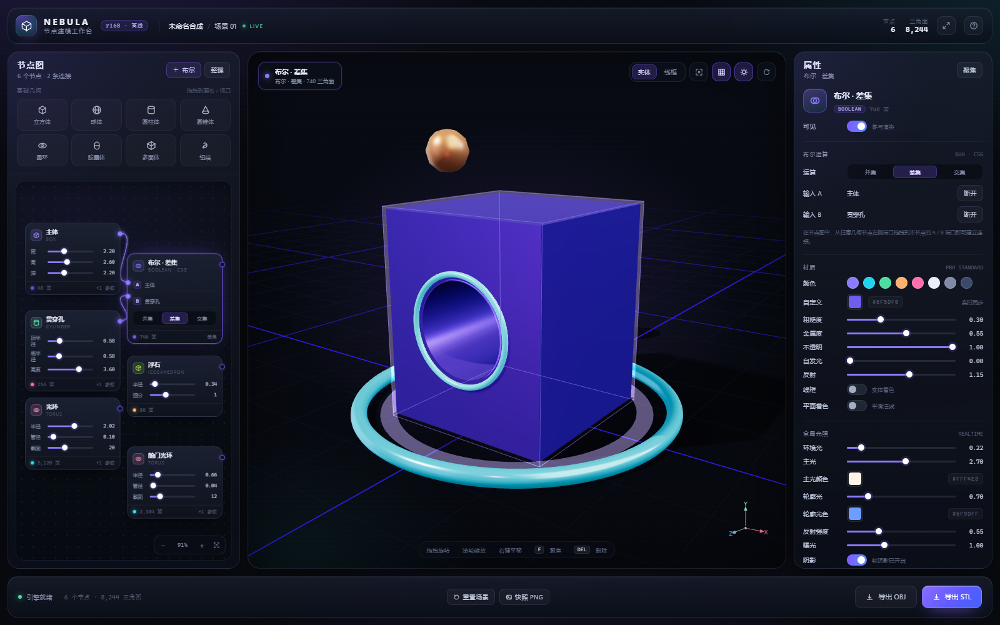

# NEBULA · 节点建模工作台

<p align="center">
  
</p>

<p align="center">
  <b>完全离线的单文件 3D 节点建模工具</b><br>
  Three.js r168 · BVH 加速布尔 · 毛玻璃深色界面 · 无需安装 / 无需联网
</p>

<p align="center">
  <code>单文件</code> · <code>零依赖安装</code> · <code>WebGL2</code> · <code>OBJ / STL / PNG 导出</code>
</p>

---

## 这是什么

NEBULA 是一个运行在浏览器里的轻量 3D 建模工作台。它把「几何体 + 布尔运算」做成可视化的节点图：左边拖出基础几何体，中间实时查看 3D 结果，右边调材质和灯光，底部一键导出模型。

整个工具只有 **一个 `index.html` 文件**（约 1.4 MB），Three.js、OrbitControls、OBJ/STL 导出器、BVH 布尔内核全部内嵌在文件里。双击打开即可使用，不启动服务器、不访问 CDN、不上传任何数据。

它适合：

- 快速概念建模、白模和体块推敲
- 打孔、开槽、镂空、零件组合等布尔造型
- 产品 / 道具 / 展台 / 科幻装置的方案预演
- PBR 材质与三点布光的快速对比
- 3D 打印前的 STL 粗模检查
- 教学演示与建模思路讲解

它不追求替代 Blender / CAD：没有角色雕刻、UV 绘制、动画绑定和精密工程公差，定位是「打开就能出形」的轻量造型工具。

> **在线体验**：<https://chun071.github.io/nebula-3d-studio/>  
> **仓库**：<https://github.com/chun071/nebula-3d-studio>

---

## 项目亮点

- **完全离线**：所有依赖通过 `importmap` + `data:` URL 内嵌，无任何外部请求；断网也能用。
- **单文件交付**：`index.html` 复制到任何电脑，双击即可运行。
- **节点式工作流**：几何体、布尔运算、材质、可见性都以节点呈现，逻辑一目了然。
- **BVH 加速布尔**：基于 `three-bvh-csg` + `three-mesh-bvh`，比传统 BSP 快一个数量级，并保留平滑法线。
- **专业级界面**：深色玻璃拟态、渐变光晕、滑杆、拖拽微调、连接线动画、选中描边与地面光环。
- **导入导出闭环**：OBJ / STL / PNG，直接衔接 Blender、C4D、游戏引擎和切片软件。
- **可审计**：没有后端、没有统计、没有跟踪；打开开发者工具 Network 面板可以看到没有任何网络请求。

---

## 快速开始

### 方式一：直接打开（推荐）

1. 下载本仓库的 [`index.html`](index.html)。
2. 双击文件，用 Chrome / Edge 打开。
3. 等待启动动画结束，即可看到内置演示场景。

> 需要浏览器支持 **WebGL2** 和 **importmap**。推荐使用最新版 Chrome / Edge（已在 Chromium 内核的 Edge 上完整验证）；Firefox 108+、Safari 16.4+ 具备 importmap 能力，但未做完整兼容测试。IE 和很老的浏览器不支持。

### 方式二：本地静态服务器

```bash
# 在仓库根目录
python -m http.server 8080
# 或
npx serve .
```

然后访问 `http://localhost:8080/`。

### 方式三：GitHub Pages

1. 把仓库推送到 GitHub。
2. 打开 **Settings → Pages**。
3. **Source** 选择 `Deploy from a branch`，分支选 `main`，目录选 `/ (root)`，保存。
4. 稍等片刻，访问：

```
https://chun071.github.io/nebula-3d-studio/
```

无需构建步骤，Pages 会直接托管 `index.html`。

---

## 界面导览

| 区域 | 位置 | 作用 |
| --- | --- | --- |
| 顶部栏 | 最上方 | 品牌、工程名、实时状态、节点/三角面统计、全屏、帮助 |
| 节点图 | 左侧 | 拖拽添加几何体、调整节点参数、连接布尔运算、管理节点 |
| 3D 视口 | 中间 | 实时渲染、旋转/缩放/平移、点选模型、聚焦、显示模式 |
| 属性面板 | 右侧 | 对象、变换、几何参数、布尔设置、材质、全局光照 |
| 底部工具栏 | 最下方 | 重置场景、PNG 快照、导出 OBJ / STL、状态统计 |

---

## 操作手册

### 1. 添加几何体

左侧「基础几何」提供 8 种图元：

| 图元 | 说明 |
| --- | --- |
| 立方体 | 可调宽/高/深与细分 |
| 球体 | 可调半径、经纬段数 |
| 圆柱体 | 可调上下半径、高度、段数 |
| 圆锥体 | 可调底半径、高度、段数 |
| 圆环 | 可调主半径、管径、截面/环绕段数 |
| 胶囊体 | 可调半径、长度、段数 |
| 多面体 | 二十面体，可调半径与细分 |
| 纽结 | 环面纽结，可调半径、管径、段数 |

添加方式：

1. **点击图元胶囊**：在节点画布中央附近创建一个节点（会自动避开已有节点）。
2. **拖拽到节点画布**：在落点创建节点。
3. **拖拽到 3D 视口**：在鼠标指向的位置放置对象；落在物体上表面时会自动贴到表面，落在侧面时会放到物体前方地面。

新对象会出现在视口中并自动被选中，右侧属性面板立即显示它的参数。

### 2. 编辑节点

- **选中**：点击节点卡片，或直接点击视口中的模型；两边同步高亮。
- **移动**：拖动节点标题栏。
- **隐藏/显示**：悬停节点，点击右上角眼睛图标；隐藏后不参与渲染。
- **重命名**：右侧「属性 → 对象」里的名称输入框。
- **删除**：选中节点后按 `Delete` / `Backspace`，或点击属性面板底部「删除节点」。
- **复制**：`Ctrl/Cmd + D`，或属性面板「复制节点」。
- **画布平移**：拖动节点图空白处。
- **画布缩放**：滚轮以光标为中心缩放；右下角 `− / 百分比 / +` 也可以调整。
- **适应视图**：点击节点图右下角的「适应」按钮，自动缩放并居中所有节点。
- **整理节点**：点击节点图顶部「整理」，按依赖关系自动分成左右两栏排列。

节点卡片里直接显示前 3 个几何参数滑杆；完整参数在右侧属性面板。例如圆环有 4 个参数，卡片显示前 3 个，第 4 个在属性面板里调。

### 3. 布尔运算

布尔节点支持三种运算：

| 运算 | 含义 | 典型用途 |
| --- | --- | --- |
| 并集 | A ∪ B | 把两个零件合并成一个实体 |
| 差集 | A − B | 在 A 上打孔、开槽、挖空 |
| 交集 | A ∩ B | 只保留两个实体重叠的部分 |

创建与连接：

1. 先添加两个几何体节点（例如立方体和圆柱）。
2. 点击节点图顶部「＋ 布尔」，会在画布上创建一个布尔节点；如果当前选中的是几何体，它会自动成为 A 输入。
3. 从几何节点右侧的**输出端口**按住拖拽，拖到布尔节点左侧的 **A / B 输入端口**上松开。
4. 在布尔节点卡片上点击「并集 / 差集 / 交集」，或在右侧属性面板里切换。
5. 调整 A/B 几何体的位置、旋转、尺寸，结果会实时更新。

断开与替换：

- 把输入端口上的连线拖到空白处松开，即可断开。
- 在输入端口上右键，也可以断开。
- 右侧「属性 → 布尔运算」里每个输入都有「断开」按钮。
- 直接把新的输出端口拖到已有输入的端口上，会替换原来的连接。

链式布尔：

布尔节点的输出端口也可以作为下一个布尔节点的输入。例如：

```
主体 ─┐
      ├─ 差集 ─┐
贯穿孔 ┘        ├─ 差集 ─ 最终模型
           球体 ┘
```

被布尔节点消费的 A/B 节点会自动从视口中隐藏——这是正常行为。隐藏布尔节点本身（点击它的眼睛），A/B 会重新显示，方便你检查原始几何体。

安全机制：

- **循环检测**：把下游节点的输出接回上游节点会被拒绝，并弹出提示。
- **缺输入提示**：只连接 A 或只连接 B 时，布尔节点会显示错误状态，不会生成错误模型。
- **面数上限**：单次布尔参与面数超过约 26,000 时会中止并提示，避免浏览器卡死。
- **异常提示**：几何体不是封闭实体或 CSG 失败时，节点和属性面板都会显示原因。

### 4. 变换与参数

选中几何体节点后，右侧「变换」区域提供：

- **位置 X/Y/Z**：按住数值框左右拖拽即可微调；`Shift` 精调（0.1 倍步长），`Alt` 加速（10 倍步长）；单击数值框可直接输入。
- **旋转 X/Y/Z**：单位为度，同样支持拖拽微调。
- **缩放**：0.15–3.00 的等比缩放滑杆。

「几何参数」区域会列出当前图元的全部参数滑杆，拖动时视口实时重建。改变几何参数后，依赖它的布尔结果会自动重算。

> 布尔节点本身没有独立变换：它的结果由 A/B 的世界坐标决定。要移动结果，请移动 A/B 几何体。

### 5. 材质

选中任意节点（包括布尔结果）后，右侧「材质」区域可以调：

| 参数 | 范围 | 说明 |
| --- | --- | --- |
| 颜色 | 色板 / 取色器 / HEX | 基础颜色 |
| 粗糙度 | 0–1 | 越小越光滑，越大越哑光 |
| 金属度 | 0–1 | 1 接近金属，0 接近塑料/陶瓷 |
| 不透明度 | 0.05–1 | 小于 1 时启用透明，实时生效 |
| 自发光 | 0–2 | 让物体自己发亮，适合光环/灯带 |
| 反射 | 0–2 | 环境反射强度（envMapIntensity） |
| 线框 | 开/关 | 只显示三角形边线 |
| 平面着色 | 开/关 | 使用逐面法线，呈低多边形风格 |

快捷色板提供 8 个常用颜色，点击即可切换；「自定义」里可以用系统取色器选任意颜色，并显示 HEX 值。

材质是**按节点独立保存**的：布尔结果有自己的一套材质，不会继承 A/B；被隐藏的节点也会保留材质设置。

### 6. 灯光

右侧「全局光照」影响整个场景：

| 参数 | 说明 |
| --- | --- |
| 环境光 | 半球环境光强度 |
| 主光 | 主方向光强度（带阴影） |
| 主光颜色 | 主光色温/颜色 |
| 轮廓光 | 背侧方向光强度 |
| 轮廓光色 | 轮廓光颜色 |
| 反射强度 | 场景环境贴图强度 |
| 曝光 | ACES 色调映射曝光 |
| 阴影 | 开启/关闭软阴影与地面接收面 |

所有滑杆都是实时生效的。视口右上角的太阳图标也可以快速开关阴影，网格图标开关地面网格。

### 7. 视口操作

| 操作 | 方式 |
| --- | --- |
| 旋转轨道 | 左键拖拽 |
| 缩放 | 滚轮 |
| 平移 | 右键拖拽（或中键） |
| 选择模型 | 左键点击模型 |
| 聚焦选中 | `F`、视口右上角「聚焦」按钮、或双击模型 |
| 实体 / 线框 | 视口右上角分段按钮 |
| 网格 / 阴影 / 自动旋转 | 视口右上角圆形按钮 |
| 取消选择 | 点击空白处或按 `Esc` |

选中对象后会出现：

- 紫色包围框
- 轮廓光边
- 地面光环
- 顶部左侧选中信息胶囊
- 右下角实时坐标轴

### 8. 导出

底部工具栏：

| 按钮 | 输出 | 说明 |
| --- | --- | --- |
| 导出 OBJ | `.obj` | 包含顶点、法线、UV、对象名和 `usemtl` 材质名；适合导入 Blender / C4D / Maya / 引擎 |
| 导出 STL | `.stl`（二进制） | 只包含三角面，世界坐标已烘焙；适合 3D 打印切片软件 |
| 快照 PNG | `.png` | 当前视口截图，深色背景，不含 UI；适合汇报和文档 |
| 重置场景 | — | 恢复到内置演示合成，并复位相机 |

导出文件名会自动带时间戳，例如：

```
nebula-20261026-172147.obj
nebula-20261026-172148.stl
nebula-20261026-172155.png
```

注意事项：

- 只导出**当前可见**的模型；被布尔消费的 A/B 不会重复导出。
- OBJ 会写入 `usemtl` 名称，但不会附带 `.mtl` 文件；颜色需要在目标软件中重新指定（或者按对象名区分）。
- STL 没有单位，1 个场景单位 = 目标软件里的 1 个单位（按需按 mm/cm/m 理解）。
- PNG 快照使用深色纯色背景，不是透明背景。

### 9. 快捷键

| 快捷键 | 功能 |
| --- | --- |
| `F` | 聚焦选中对象 |
| `Delete` / `Backspace` | 删除选中节点 |
| `Ctrl/Cmd + D` | 复制选中节点 |
| `Esc` | 取消选择 / 关闭帮助弹层 |
| 左键拖拽 | 旋转视口 |
| 滚轮 | 缩放视口 |
| 右键拖拽 | 平移视口 |
| 双击模型 | 聚焦该模型 |

---

## 内置演示场景

打开文件后默认加载一个 6 节点的合成，用来展示节点图、布尔、材质和灯光：

| 节点 | 类型 | 作用 |
| --- | --- | --- |
| 主体 | 立方体 | 2.2 × 2.6 × 2.2 的主块 |
| 贯穿孔 | 圆柱体 | 半径 0.58、长度 3.6，绕 X 轴旋转 90° 横穿主块 |
| 布尔 · 差集 | 布尔 | 主体 − 贯穿孔，形成贯穿圆孔；结果 740 三角面 |
| 舱门光环 | 圆环 | 嵌在孔口的青色发光环 |
| 光环 | 圆环 | 地面上的青色光环 |
| 浮石 | 多面体 | 悬浮在空中的暖色二十面体 |

默认 6 个节点、2 条连接、8,244 个可见三角面。

---

## 功能清单

- [x] 8 种基础几何体
- [x] 点击添加 / 节点画布拖放 / 3D 视口拖放
- [x] 节点内联参数滑杆 + 属性面板全参数
- [x] 并集 / 差集 / 交集
- [x] 端口拖线连接、断开、替换、链式布尔、循环检测
- [x] 节点拖动、画布平移缩放、适应视图、自动整理
- [x] 对象重命名、显示/隐藏、复制、删除
- [x] 位置/旋转拖拽微调、等比缩放
- [x] PBR 材质：颜色、粗糙度、金属度、透明度、自发光、反射、线框、平面着色
- [x] 全局灯光：环境光、主光、轮廓光、颜色、曝光、阴影
- [x] OrbitControls 轨道漫游、缩放、平移、自动旋转
- [x] 点选模型、选中描边/包围框/地面光环、聚焦
- [x] 实体/线框模式、网格/阴影开关、坐标轴
- [x] OBJ / STL / PNG 导出
- [x] 快捷键与帮助弹层
- [x] 完全离线、无外部资源

---

## 技术实现

### 单文件封装

`index.html` 通过 `importmap` 把以下依赖映射到 `data:text/javascript;base64,...`：

```json
{
  "imports": {
    "three": "data:text/javascript;base64,...",
    "three-mesh-bvh": "data:text/javascript;base64,...",
    "three-bvh-csg": "data:text/javascript;base64,...",
    "three/addons/controls/OrbitControls.js": "data:text/javascript;base64,...",
    "three/addons/exporters/OBJExporter.js": "data:text/javascript;base64,...",
    "three/addons/exporters/STLExporter.js": "data:text/javascript;base64,..."
  }
}
```

没有 `https://` 依赖，没有字体、贴图、模型下载。唯一的“贴图”都是运行时生成的：

- 环境贴图：`DataTexture`（256×128 HDR 渐变 + 柔光箱），经 `PMREMGenerator` 预过滤
- 接触阴影：`DataTexture` 径向渐变
- 坐标轴文字：CanvasTexture
- 网格：GLSL3 程序化网格着色器（`fwidth` 抗锯齿）
- 页面噪点：内联 SVG `feTurbulence`

### 渲染管线

```
节点图
  → 几何体构建（BufferGeometry）
  → 世界矩阵烘焙
  → 版本缓存
  → BVH CSG（布尔节点）
  → MeshStandardMaterial
  → 阴影 / 环境反射 / ACES 色调映射
  → WebGL 视口
```

- 渲染器：`WebGLRenderer`，`alpha: true`，透明清屏，背景由 CSS 渐变提供
- 色调映射：`ACESFilmicToneMapping`
- 阴影：`PCFSoftShadowMap`，2048² 阴影贴图
- 环境：程序化 HDR + `scene.environment`
- 网格：GLSL3 片元着色器，屏幕空间线宽，径向淡出
- 选中：轮廓壳（BackSide + Additive）、Box3Helper、地面光环

### 节点求值

每个节点有 `rev` 版本号。布尔节点的缓存键由自身版本和 A/B 的递归版本组成，只有输入发生变化时才重新计算 CSG。几何体缓存会被复用，不再被引用的 `BufferGeometry` 会被自动 `dispose()`。

### 布尔内核

- `three-bvh-csg@0.0.17`
- `three-mesh-bvh@0.8.3`
- 输入几何体先构建 BVH，再做 CSG 求值
- 保留顶点法线（曲面平滑）、UV 和对象分组
- 面数保护：单次布尔总面数超过 26,000 时抛错并提示
- 对不相交的 AABB 做快速短路：并集直接合并、差集直接返回 A、交集返回空

---

## 项目结构

```
.
├── index.html                       # 单文件应用（全部依赖内嵌）
├── README.md                        # 本文档
├── THIRD-PARTY.md                   # 第三方依赖与许可说明
└── screenshots/
    └── nebula-overview.png          # 界面预览
```

没有 `node_modules`、没有构建产物、没有后端服务。

---

## 常见问题

**Q：打开后黑屏 / 一直停在启动动画？**
A：确认浏览器支持 WebGL2，并且没有关闭硬件加速。推荐 Chrome / Edge 最新版；如果使用远程桌面或虚拟机，可能需要启用软件 WebGL。

**Q：布尔运算没有效果？**
A：检查三件事：
1. A/B 是否都已连接；
2. 两个几何体是否真的重叠；
3. 布尔节点是否被隐藏（眼睛图标）。

**Q：为什么做了布尔之后，原来的两个几何体不见了？**
A：它们被布尔节点消费了，这是正常的。点击布尔节点的眼睛隐藏它，A/B 就会重新显示。

**Q：布尔报错“面数超出上限”？**
A：降低球体/圆环/纽结的段数，或拆分布尔步骤。默认上限约 26,000 三角面。

**Q：导出的 OBJ 没有颜色？**
A：OBJ 只导出 `usemtl` 名称，不附带 `.mtl` 文件。请在 Blender/C4D 等软件里按对象名重新赋材质，或自行根据名称创建 MTL。

**Q：STL 用什么单位？**
A：没有单位，1 个场景单位就是 1 个单位。导入切片软件时按需要理解为 mm / cm / m。

**Q：能保存工程吗？**
A：当前版本没有工程保存/加载，刷新页面会回到演示场景。请用 OBJ/STL/PNG 保留结果。

**Q：能导入自己的模型吗？**
A：当前版本只支持内置 8 种图元，不支持 OBJ/GLTF 导入。

**Q：手机上能用吗？**
A：可以打开，但界面和交互是为桌面浏览器设计的，推荐 1280px 以上宽度。

**Q：文件为什么这么大？**
A：Three.js、布尔内核、导出器和所有依赖都内嵌在文件里，换来的是完全离线和单文件交付。

**Q：有没有联网或上传数据？**
A：没有。打开开发者工具 → Network，刷新页面，可以看到没有任何外部请求。

---

## 已知限制

- 没有撤销/重做、工程保存/加载、模型导入。
- 仅支持 8 种内置图元，没有倒角、曲面放样、自定义网格。
- 布尔只适用于封闭实体；共面接触或极薄几何可能出现轻微接缝。
- 单次布尔总面数上限约 26,000。
- 没有 UV 编辑、贴图绘制、骨骼动画、渲染队列。
- OBJ 不附带 MTL；PNG 不是透明背景。
- 需要 WebGL2，不支持 IE 和很老的浏览器。
- 单线程计算，极端复杂场景可能掉帧。

---

## 第三方依赖与致谢

本项目内嵌并使用了以下开源项目，感谢作者与社区：

| 依赖 | 版本 | 许可 | 用途 |
| --- | --- | --- | --- |
| [three.js](https://threejs.org/) | r168 | MIT | WebGL 渲染、几何体、材质、灯光 |
| [OrbitControls](https://threejs.org/docs/#examples/en/controls/OrbitControls) | r168 | MIT | 轨道相机控制 |
| [OBJExporter](https://threejs.org/docs/#examples/en/exporters/OBJExporter) | r168 | MIT | OBJ 导出 |
| [STLExporter](https://threejs.org/docs/#examples/en/exporters/STLExporter) | r168 | MIT | STL 导出 |
| [three-mesh-bvh](https://github.com/gkjohnson/three-mesh-bvh) | 0.8.3 | MIT | BVH 加速 |
| [three-bvh-csg](https://github.com/gkjohnson/three-bvh-csg) | 0.0.17 | MIT | BVH 布尔运算 |

详见 [THIRD-PARTY.md](THIRD-PARTY.md)。

---

## 许可

本仓库暂未附带许可证。应用代码由仓库所有者保留权利；第三方依赖遵循各自的 MIT 许可。

如果你准备把这个项目开源，建议补充一个 `LICENSE`（例如 MIT），并在 README 中注明。

---

## 更新日志

### v1.0.0

- 首个版本：8 种几何体、三种布尔、节点图、PBR 材质、全局灯光、OBJ/STL/PNG 导出、完全离线单文件。
